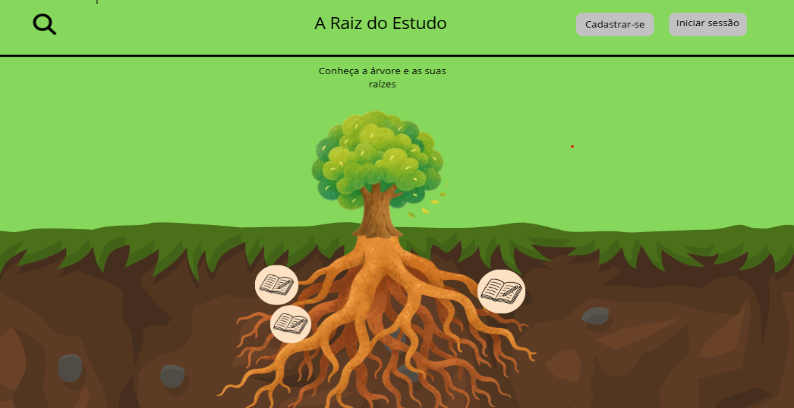

# A √Raiz do Estudo




> Plataforma web de cursos interativos e lúdicos de matemática voltada inicialmente ao Ensino Fundamental (com expansão planejada para o Ensino Médio e Superior). A estilização é inspirada na natureza, organizando a sequência de módulos como as raízes de uma árvore e unindo teoria, história da matemática, jogos e foco em acessibilidade.

## 🎯 Público-Alvo

Estudantes de qualquer etapa de ensino ou interessados em matemática que buscam sanar dúvidas e desenvolver interesse pela área de forma visual e interativa.

## ✨ Funcionalidades

O projeto conta com as seguintes funcionalidades:

- [x] **Árvore de Módulos (Cursar):** Módulos dispostos nas raízes de uma árvore contendo teoria, curiosidades da história da matemática, interações visuais e listas de exercícios.
- [x] **Minijogos Educativos (Jogar):** Jogos integrados para estimular o aprendizado, incluindo treino de velocidade com questões de Aritmética, Álgebra e Geometria.
- [x] **Cadastro e Progresso Local:** Salvamento do progresso nos cursos e recordes nos jogos utilizando `localStorage`.
- [x] **Acessibilidade:** Modos de cores adaptados para daltonismo (Protanopia, Deuteranopia e Tritanopia), reforço visual com ícones, HTML semântico e atributos `alt` descritivos para leitores de tela.
- [x] **Sistema de Pesquisa:** Busca para localizar cursos ou qualquer módulo existente.
- [x] **Consulta Rápida (Consultar):** Exibição de uma breve descrição do assunto ao posicionar o mouse sobre questões, acompanhada de link para o módulo relacionado.
- [x] **Responsividade:** Interface adaptada para celulares, tablets, notebooks e monitores desktop.

## 💻 Pré-requisitos

Para executar ou editar o projeto localmente, você precisará de:

- Um navegador web atualizado.
- `Git` instalado (opcional, caso queira clonar via terminal).

## 🚀 Como executar o projeto

1. Clone este repositório no seu computador:

```bash
git clone [https://github.com/enzoanjolimornelas-commits/aRaizDoEstudo.git](https://github.com/enzoanjolimornelas-commits/aRaizDoEstudo.git)
